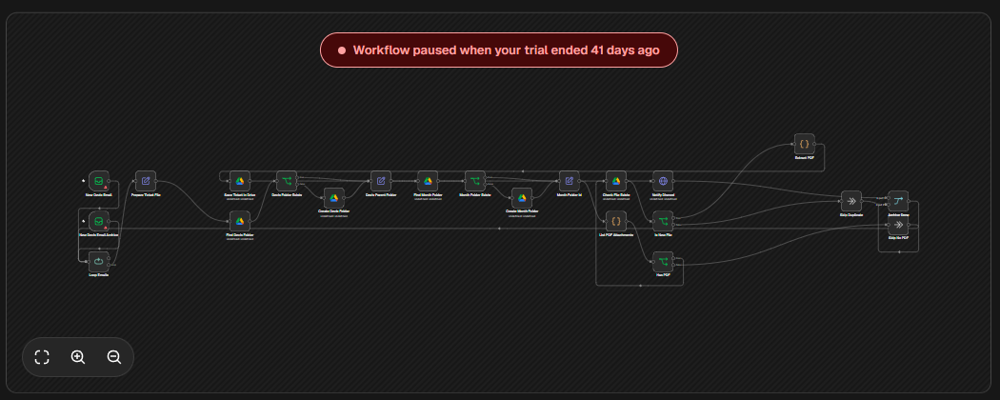

# Archivage automatique des devis reçus par e-mail (n8n → Google Drive → Discord)

Workflow d'automatisation construit avec **n8n**. Il surveille une boîte mail, récupère les **devis en PDF** reçus en pièce jointe, les **range automatiquement dans Google Drive** (un dossier par mois, nom de fichier normalisé, sans doublon) et **prévient sur Discord** à chaque nouveau devis archivé, avec le lien vers le fichier.

> Projet personnel.

---

## Le problème

Les devis arrivent par e-mail, en pièce jointe, chacun avec son propre nom de fichier. Les retrouver plus tard veut dire fouiller la boîte mail, et les enregistrer à la main est long et source d'oublis ou de doublons. L'idée : **chaque devis reçu est archivé tout seul, au bon endroit, sous un nom lisible**, et je suis prévenu.

## Ce que fait le workflow

```
 Boîte mail (IMAP)        n8n                          Google Drive                 Discord
┌───────────────┐   ┌────────────────────┐   ┌──────────────────────────┐   ┌──────────────────┐
│ E-mails non   │   │ Pièces jointes PDF │   │ Devis/                   │   │ « Nouveau devis  │
│ lus, objet    │─▶ │ + nom normalisé    │─▶ │   └─ 2026-11/            │─▶ │   archivé » +    │
│ « Devis »     │   │ + contrôle doublon │   │        └─ fichier.pdf    │   │   lien Drive     │
└───────────────┘   └────────────────────┘   └──────────────────────────┘   └──────────────────┘
```

1. **Déclencheur e-mail (IMAP)** : n8n relève les e-mails **non lus** dont l'objet contient « Devis », dans la boîte de réception **et** dans le dossier Archive, puis les marque comme lus.
2. **Traitement un par un** : chaque e-mail passe dans une boucle, pour qu'un message à plusieurs pièces jointes ne bloque pas les autres.
3. **Nom de fichier normalisé** : `AAAA-MM-JJ_expéditeur_objet_nom-d-origine.pdf`, débarrassé des caractères spéciaux.
4. **Arborescence Drive** : le workflow cherche le dossier `Devis` puis le sous-dossier du mois (`AAAA-MM`), et **les crée s'ils n'existent pas**.
5. **Filtrage** : seules les pièces jointes **PDF** sont gardées (petit script JavaScript dans un nœud Code).
6. **Anti-doublon** : si un fichier du même nom existe déjà dans le dossier du mois, il est ignoré.
7. **Enregistrement** du PDF dans Google Drive.
8. **Notification Discord** (webhook) : message « Nouveau devis archivé » avec le nom du fichier et son lien.

Un **second workflow** (`workflow-error-notifier.json`) sert de gestionnaire d'erreurs : si l'archivage échoue, une alerte est envoyée sur Discord.

## Aperçu



## Outils utilisés

| Outil | Rôle |
|---|---|
| **n8n** | Orchestration du workflow (déclencheur, conditions, boucle, fusion des branches) |
| **IMAP** | Lecture des e-mails et téléchargement des pièces jointes |
| **JavaScript** (nœuds Code) | Filtrage des PDF et construction des noms de fichiers |
| **Google Drive** | Recherche / création des dossiers, contrôle des doublons, stockage des PDF |
| **Discord** (webhook) | Notification à chaque devis archivé, et alerte en cas d'erreur |

## Ce que ce projet m'a appris

- Concevoir un **flux d'automatisation de bout en bout** : déclencheur, traitement, stockage, notification.
- Gérer les **cas particuliers** : e-mail sans PDF, fichier déjà archivé, dossier absent à créer.
- Écrire de **petits scripts JavaScript** dans n8n pour manipuler les pièces jointes (données binaires).
- **Organiser automatiquement des fichiers** dans Google Drive (un dossier par mois).
- Prévoir un **workflow de gestion d'erreurs** pour être alerté quand quelque chose casse.
- Faire communiquer des **services tiers** (authentification, format des données d'un nœud à l'autre).

## Utiliser ce workflow

1. Télécharger `workflow.json` (et, si besoin, `workflow-error-notifier.json`).
2. Dans n8n : **Workflows → Import from file**.
3. Créer ses propres identifiants dans n8n (compte IMAP, Google Drive) et les associer aux nœuds.
4. Dans les nœuds **Notify Discord**, remplacer `VOTRE_WEBHOOK_ICI` par l'URL de son propre webhook Discord.
5. Dans les paramètres du workflow principal, choisir le workflow d'erreurs comme **Error Workflow**.
6. Activer le workflow.

> 🔒 Les fichiers publiés ne contiennent **aucun mot de passe ni clé** : l'URL du webhook Discord a été retirée et chacun doit utiliser ses propres identifiants.

## Pistes d'amélioration

- Ajouter une étape d'**IA** (par exemple l'API Claude) pour extraire du devis le fournisseur, le montant et la date, et les inscrire dans un tableau de suivi.
- Mettre un résumé du devis directement dans le message Discord.
- Rendre le mot-clé recherché (« Devis ») et le dossier de destination paramétrables.

---

**Andy Pauriac** · [github.com/Endygit](https://github.com/Endygit)
